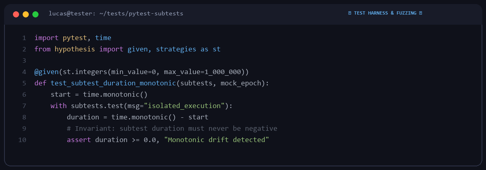

# Lucas Meyer

  

Test harness engineer & edge-case investigator based in Berlin, Germany.  
Specializing in automated testing frameworks, fuzzing harnesses, and deterministic failure isolation.

---

### 🛡️ Test Framework Contributions & Fixes

| Framework | Area | Focus | Status |
|---|---|---|---|
| **[pytest-dev/pytest](https://github.com/pytest-dev/pytest)** | Subtests Engine | Monotonic timing references and subtest reporting | Contributor |
| **[HypothesisWorks/hypothesis](https://github.com/HypothesisWorks/hypothesis)** | Property Testing | Strategy generation & shrinker bounds | Research |
| **[tox-dev/tox](https://github.com/tox-dev/tox)** | Environment Matrix | Isolated environment configuration & virtualenv hooks | Contributor |

---

### 🧪 Testing Principles

1. **Deterministic Timing**: Monotonic clock references over system time; elimination of flaky race conditions.
2. **Defensive Assertions**: Strict bounds checking and regression verification across Python versions.
3. **Clean Repros**: Isolating edge cases to minimal reproducible test cases before patching.

---
*Pytest • Hypothesis • Tox • Coverage • Python Runtimes*